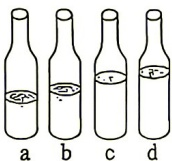

7. 在 a、b、c、d 4 个相同的玻璃瓶中，装入不同高度的水，下列说法正确的是 ( )

A. 用嘴依次吹瓶口，a 的音调最高

B. 用筷子依次敲打瓶口，d 的音调最高

C. 用嘴依次吹瓶口，空气柱振动发声

D. 用筷子依次敲打瓶口，玻璃瓶振动发声

> [!question]- 点击查看答案与解析
> 【答案】C
> 
> 【考点】音调与振动频率的关系、发声体的判断 → [[【初中物理知识点体系-北师大版】#3-2 声音的特性]]、[[【初中物理知识点体系-北师大版】#3-1 声音的产生与传播]]
> 
> 【解析】
> 由图可知，四个瓶中水量由少到多为 a、b、c、d。
> - 选项A：用嘴吹瓶口时，发声体是瓶内的空气柱；水越少空气柱越长，振动越慢，音调越低，所以 a 的音调最低而不是最高，错误；
> - 选项B：用筷子敲打瓶口时，发声体是瓶（连同瓶中的水）；水越多，振动越慢，音调越低，d 中水最多，音调最低，错误；
> - 选项C：吹瓶口时是空气柱振动发声，正确；
> - 选项D：敲打瓶口时发声体是瓶和瓶中的水共同振动，“玻璃瓶振动发声”表述不完整，且本题为单选，错误。
> 
> 【易错点】“吹瓶口”与“敲瓶口”的声源不同：吹——空气柱（水越多音调越高）；敲——瓶与水（水越多音调越低）。
