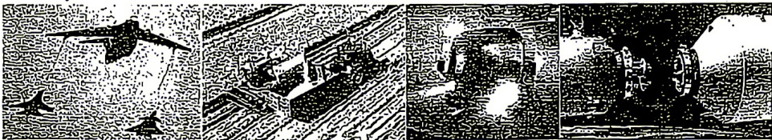

8. 如图所示是生产、生活中有关运动与静止相对性的知识，下列说法中不正确的是 ( )

A. 加油机在空中给战斗机加油时，以加油机为参照物，战斗机是静止的

B. 运水稻的车辆和联合收割机以同样快慢向同一方向前进时，它们是相对静止的

C. 在汽车风洞试验中，以空气为参照物，汽车是静止的

D. “天宫一号”与“神舟八号”对接成功时，它们是相对静止的

> [!question]- 点击查看答案与解析
> 【答案】C
> 
> 【考点】参照物与运动和静止的相对性 → [[【初中物理知识点体系-北师大版】#2-2 运动的描述]]
> 
> 【解析】
> 判断物体运动还是静止，要看被研究物体相对于参照物的位置是否发生变化。
> - 选项A：加油时战斗机与加油机保持相同速度、相同方向，相对位置不变，以加油机为参照物战斗机静止，正确；
> - 选项B：两车快慢相同、方向相同，相对位置不变，是相对静止，正确；
> - 选项C：风洞试验中空气高速流过汽车，以空气为参照物，汽车的位置不断变化，汽车是运动的，错误；
> - 选项D：对接成功后两者相对位置不变，是相对静止，正确。
> 
> 【易错点】风洞试验中以流动的空气为参照物，汽车是运动的；不能把“汽车不动”误当作“相对空气静止”。
