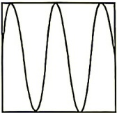
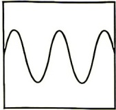
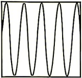
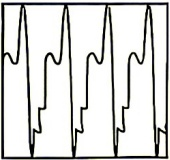

9. 如图所示是几种声音输入同一个示波器上时显示的波形。下列说法正确的是 ( )

甲

乙

丙

丁

A. 甲、乙两种声音的响度相同

B. 甲、丁两种声音的响度相同

C. 乙、丙两种声音的音调相同

D. 乙、丁两种声音的音色相同

> [!question]- 点击查看答案与解析
> 【答案】B
> 
> 【考点】由波形图比较音调、响度和音色 → [[【初中物理知识点体系-北师大版】#3-2 声音的特性]]
> 
> 【解析】
> 波形图中，波峰的个数反映频率（音调），波峰的高低反映振幅（响度），波形的形状反映音色。
> - 选项A：甲、乙在相同时间内波峰个数相同（频率相同），但甲的振幅明显大于乙，响度不同，错误；
> - 选项B：甲、丁的振幅都较大且基本相同，响度相同，正确；
> - 选项C：乙在相同时间内有 3 个波峰，丙有 5 个波峰，频率不同，音调不同，错误；
> - 选项D：丁的波形不规则，与乙（规则的简谐波形）形状不同，音色不同，错误。
> 
> 【易错点】把“波峰个数”和“波峰高低”混淆：个数看音调，高低看响度，形状看音色。
