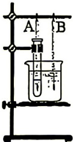
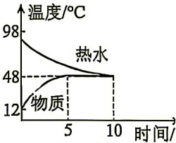

10. 如图甲所示，某同学用装有某种物质的试管放在装有热水的大烧杯中进行熔化实验。根据温度计 A 和 B 的示数，绘制该物质和热水的温度随时间变化关系如图乙所示。以下分析不正确的是 ( )

甲

乙

A. 该物质的熔点是 $48^{\circ}\text{C}$

B. 在 $5\sim10\text{ min}$ 之间该物质吸收热量

C. 第 $8\text{ min}$ 时，该物质处于固液共存状态

D. $10\text{ min}$ 后，该物质会继续熔化

> [!question]- 点击查看答案与解析
> 【答案】D
> 
> 【考点】熔化图像、熔点、熔化条件 → [[【初中物理知识点体系-北师大版】#1-2 熔化和凝固]]、[[【初中物理知识点体系-北师大版】#1-3 汽化和液化]]
> 
> 【解析】
> - 选项A：图像中该物质的温度在 $5\sim10\text{ min}$ 内保持 $48^{\circ}\text{C}$ 不变，说明它的熔点是 $48^{\circ}\text{C}$，正确；
> - 选项B：$5\sim10\text{ min}$ 是熔化过程，虽温度不变，但物质仍在从热水中吸收热量，正确；
> - 选项C：第 $8\text{ min}$ 位于熔化过程中，物质处于固液共存状态，正确；
> - 选项D：$10\text{ min}$ 时热水的温度已降到 $48^{\circ}\text{C}$ 并与物质温度相同，之后热水继续散热降温，低于 $48^{\circ}\text{C}$，物质将放热凝固，不会继续熔化，错误。
> 
> 【易错点】只看到“温度不变”就判断“继续吸热熔化”，忽略熔化的条件是“持续吸热”；热源温度低于熔点时物质反而会凝固。
