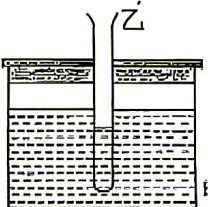

12. 如图甲容器内装有水，乙试管内也装有水，并通过甲容器密封盖上的孔插入甲容器的水中，且乙试管与密封盖紧密接触，现给甲容器加热，则一段时间后，下列正确的是 ( )

A. 甲容器内的水沸腾，乙试管内的水不会沸腾

B. 甲容器、乙试管内的水同时沸腾

C. 都会沸腾，但甲容器内的水先沸腾

D. 都会沸腾，但乙试管内的水先沸腾

> [!question]- 点击查看答案与解析
> 【答案】A
> 
> 【考点】沸腾的条件（达到沸点并继续吸热） → [[【初中物理知识点体系-北师大版】#1-3 汽化和液化]]
> 
> 【解析】
> 甲容器直接受热，水温达到沸点 $100^{\circ}\text{C}$（标准大气压）后继续吸热，甲中的水沸腾。
> 乙试管中的水通过热传递升温，最终温度也达到 $100^{\circ}\text{C}$，但此时它与甲容器中的水温度相同，无法再发生热传递，不能继续吸热，因此乙试管中的水只能达到沸点而不能沸腾。
> - 选项A：正确；
> - 选项B、C、D：都认为乙试管的水会沸腾，错误。
> 
> 【易错点】只记住“达到沸点”而忽略“继续吸热”这一条件；温度相同即停止热传递，这是“试管中的水不会沸腾”的根本原因。
