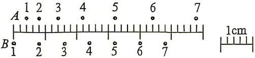

13. 如图是小球 A、B 沿直线运动的频闪照片，频闪照相机每隔 0.2s 闪拍一次，图上数字为闪光时刻编号，分析照片可知：下列说法正确的是 ( )

A. 小球 A 做匀速直线运动

B. 小球 A 从编号 1 到编号 6 运动的平均速度为 $0.4\text{ m/s}$

C. 小球 B 可能做匀速直线运动

D. 小球 B 运动的速度越来越快

> [!question]- 点击查看答案与解析
> 【答案】C
> 
> 【考点】匀速直线运动与变速直线运动的判断、平均速度 → [[【初中物理知识点体系-北师大版】#2-3 运动的快慢]]、[[【初中物理知识点体系-北师大版】#2-4 平均速度的测量]]
> 
> 【解析】
> - 选项A：照片中小球 A 相邻两个闪光位置间的距离基本相等，说明它在相等时间内通过的路程相等，做匀速直线运动，正确；
> - 选项B：编号 1 到 6 共 5 个时间间隔，历时 $t=5\times0.2\text{ s}=1\text{ s}$；按图中标尺量得路程约 $5\text{ cm}=0.05\text{ m}$，平均速度约 $0.05\text{ m/s}$，不是 $0.4\text{ m/s}$，错误；
> - 选项C：小球 B 相邻闪光位置间的距离逐渐减小，相等时间内路程不等，不可能做匀速直线运动，错误；
> - 选项D：小球 B 相同时间内的路程越来越短，速度越来越慢，不是越来越快，错误。
> 
> 【易错点】读频闪照片时要先数“间隔数”而不是“位置数”：编号 1 到 6 是 5 个时间间隔；同时注意 B 的间距是递减（减速）而非递增（加速）。
