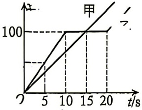

14. 甲、乙两同学从同一地点同时向相同方向做直线运动，他们通过的路程随时间变化的图像如图所示。由图像可知 ( )

$①$ 在 0-10s 内，甲比乙快

$②$ 两同学将在距离出发点 100m 处相遇

$③$ 在 10-20s 内，乙同学静止不动

$④$ 前 20s，乙同学的平均速度为 10m/s

A. $②③$

B. $①③$

C. $①④$

D. $②④$

> [!question]- 点击查看答案与解析
> 【答案】A
> 
> 【考点】s-t 图像的分析、速度与平均速度的计算 → [[【初中物理知识点体系-北师大版】#2-3 运动的快慢]]、[[【初中物理知识点体系-北师大版】#2-4 平均速度的测量]]
> 
> 【解析】
> 由图像可知：甲做匀速直线运动，$15\text{ s}$ 时通过 $100\text{ m}$；乙在 $0\sim10\text{ s}$ 内做匀速直线运动，$10\text{ s}$ 时通过 $100\text{ m}$，$10\sim20\text{ s}$ 内路程保持 $100\text{ m}$ 不变。
> - $①$ 在 $0\sim10\text{ s}$ 内，乙通过 $100\text{ m}$，甲通过的路程小于 $100\text{ m}$，乙比甲快，故错误；
> - $②$ $15\text{ s}$ 时甲、乙的路程都是 $100\text{ m}$，两同学在距出发点 $100\text{ m}$ 处相遇，正确；
> - $③$ $10\sim20\text{ s}$ 内乙的路程不变，处于静止状态，正确；
> - $④$ 前 $20\text{ s}$ 乙通过的路程为 $100\text{ m}$，平均速度 $v=\frac{100\text{ m}}{20\text{ s}}=5\text{ m/s}$，不是 $10\text{ m/s}$，错误。
> 
> 综上，正确的是 $②③$，选 A。
> 
> 【易错点】把乙在 $0\sim10\text{ s}$ 内的速度（$10\text{ m/s}$）当成前 $20\text{ s}$ 的平均速度；读 s-t 图像时要用“总路程除以总时间”求平均速度。
