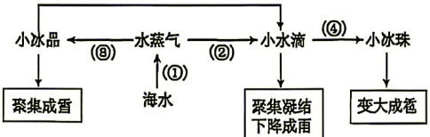

16. 通过水的三态变化，地球上的水不停地循环，如图所示。水循环各过程所发生的物态变化是 ( )

A. 过程 $①$ 是海水吸热升华成水蒸气

B. 过程 $②$ 是水蒸气放热液化成小水滴

C. 过程 $③$ 是水蒸气放热凝华成小冰晶

D. 过程 $④$ 是小水滴吸热凝华成小冰晶

> [!question]- 点击查看答案与解析
> 【答案】BC
> 
> 【考点】汽化、液化、凝华、凝固及吸放热 → [[【初中物理知识点体系-北师大版】#1-3 汽化和液化]]、[[【初中物理知识点体系-北师大版】#1-4 升华和凝华]]、[[【初中物理知识点体系-北师大版】#1-2 熔化和凝固]]
> 
> 【解析】
> - 选项A：海水变成水蒸气是汽化（蒸发），吸热，不是升华，错误；
> - 选项B：水蒸气变成小水滴是液化，放热，正确；
> - 选项C：水蒸气直接变成小冰晶是凝华，放热，正确；
> - 选项D：小水滴变成小冰珠是由液态变为固态，属于凝固，放热，不是凝华，错误。
> 
> 故选 BC。
> 
> 【易错点】混淆“凝华”（气→固）与“凝固”（液→固）；液化、凝华、凝固都放热，汽化、熔化、升华都吸热。
