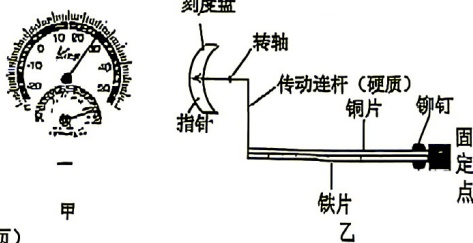

18. 如图甲所示为双金属片温度计，结构如图乙所示，感温元件由铜片和铁片铆合而成。已知在相同温度变化下，铜的热膨胀程度大于铁，当环境温度变化时，该双金属片会弯曲，带动轻质指针绕着转轴转动（转轴是固定不动的）。下列说法正确的是 ( )

A. 指针水平所指位置一定是 $0^{\circ}\text{C}$

B. 当环境温度升高时，指针将顺时针转动

C. 将转轴左侧的指针做得更长（指针能正常随温度变化而偏转），会让该温度计更灵敏

D. 将转轴左侧的指针做得更长（指针能正常随温度变化而偏转），会让该温度计的量程变小

> [!question]- 点击查看答案与解析
> 【答案】BCD
> 
> 【考点】温度计的原理、双金属片的热膨胀 → [[【初中物理知识点体系-北师大版】#1-1 温度及其测量]]
> 
> 【解析】
> 双金属片上铜片在上、铁片在下，右端固定。温度升高时，铜的膨胀程度大于铁，铜片伸长更多，双金属片向上弯曲（左端上翘），通过传动连杆带动指针顺时针转动；温度降低时则相反。
> - 选项A：刻度盘的零刻度位置是根据标定确定的，指针水平位置不一定是 $0^{\circ}\text{C}$，错误；
> - 选项B：温度升高时双金属片上翘，指针顺时针转动，正确；
> - 选项C：指针越长，同样的偏转角度下指针端点移动的距离越大，刻度分得更细，温度计更灵敏，正确；
> - 选项D：指针越长，刻度盘上相同的弧长所对应的温度变化越小，温度计的量程变小，正确。
> 
> 【易错点】“更灵敏”与“量程”是相互制约的：放大偏转效果必然使可测范围减小，类似电流表换用大量程/小量程的道理。
