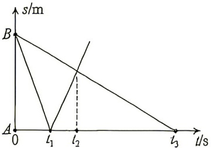

19. 一辆匀速行驶的高速列车，车头在 B 处鸣笛后，在 $t_{1}$ 时刻位于车头的司机听到正前方隧道入口 A 处山崖反射回来的回声，再过一段时间，在 $t_{3}$ 时刻司机也到达隧道口。车、声音的位置与时间关系如图所示，图中 $t_{1}=5s$，声音在空气中速度为 340 m/s，下列判断正确的是 ( )

A. 列车的速度为 68 m/s

B. 由图像可知，$t_2 : t_3$ 为 1:3

C. 司机听到回声时，声音通过的路程是列车的 5 倍

D. 如果列车的速度加快，则 $t_{1}:t_{2}<3:5$

> [!question]- 点击查看答案与解析
> 【答案】ABC
> 
> 【考点】声速与回声测距、s-t 图像与速度计算 → [[【初中物理知识点体系-北师大版】#3-1 声音的产生与传播]]、[[【初中物理知识点体系-北师大版】#2-3 运动的快慢]]
> 
> 【解析】
> 设鸣笛处 B 到隧道口 A 的距离为 $L$，列车速度为 $v$。由图像可知：$t_{1}$ 是声音到达 A 的时刻，$t_{2}$ 是声音反射后与列车相遇（司机听到回声）的时刻，$t_{3}$ 是列车到达 A 的时刻。
> - 声音从 B 传到 A：$L=v_{\text{声}}t_{1}=340\text{ m/s}\times5\text{ s}=1700\text{ m}$。
> - 声音反射后与列车相遇时，声音通过的总路程为 $340t_{2}$，列车通过的路程为 $vt_{2}$，且 $2L=340t_{2}+vt_{2}$，即 $3400=(340+v)t_{2}$。
> - 列车到达 A：$L=vt_{3}$，即 $1700=vt_{3}$。
> 
> 由图像读得 $t_{2}:t_{3}=1:3$，即 $\frac{2L/(340+v)}{L/v}=\frac{2v}{340+v}=\frac{1}{3}$，解得 $v=68\text{ m/s}$，于是 $t_{3}=1700/68\text{ s}=25\text{ s}$，$t_{2}=2L/(340+68)\text{ s}\approx8.3\text{ s}$。
> - 选项A：$v=68\text{ m/s}$，正确；
> - 选项B：$t_{2}:t_{3}=8.3:25=1:3$，正确；
> - 选项C：司机听到回声时，声音路程 $340\times8.3\text{ m}\approx2833\text{ m}$，列车路程 $68\times8.3\text{ m}\approx567\text{ m}$，比值约为 5，正确；
> - 选项D：若列车速度加快，$t_{1}=L/340$ 不变，而 $t_{2}=2L/(340+v)$ 变小，故 $t_{1}:t_{2}$ 变大（大于 $3:5$），错误。
> 
> 故选 ABC。
> 
> 【易错点】①题干“在 $t_{1}$ 时刻听到回声”与图像标号不一致，按图像 $t_{1}$ 是声音到达隧道口的时刻、$t_{2}$ 才是听到回声的时刻；②求“声音通过的路程”要用 $v_{\text{声}}t$，不能只算单程。
