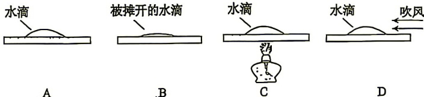
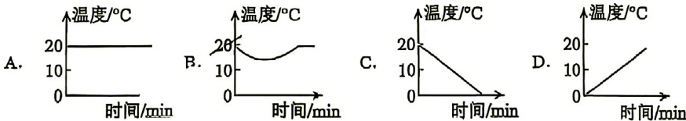

21. 小明在物理课上学习了液体蒸发快慢与液体温度、液体表面积、液体表面上方气流速度三个因素有关。星期天，他做了一次家庭实验进行进一步验证：在四块相同的玻璃板上各滴一滴质量相同的水，然后进行如图甲所示的实验探究：

（1）通过对比 A、B，可以验证水蒸发的快慢与水的 ___ 有关。

（2）通过对比 ___ 两图，可以得出水蒸发快慢与水面上方空气流动快慢有关。

（3）实验结束后，同学们又设计了一个实验并及时观察到了现象：在玻璃板上，同时用酒精和水分别涂一个大小相同的圆斑，观察发现 ___ （选填“酒精”或“水”）圆斑先干了，从而说明了其他因素一定时，液体蒸发的快慢还与 ___ 有关。

（4）若室内温度为 $20^{\circ}\text{C}$，此时用靛有少量酒精的棉花涂抹一下温度计的玻璃泡，随着酒精的迅速蒸发，下列各图能比较正确反映温度计示数随时间变化的是 ___ 。

> [!question]- 点击查看答案与解析
> 【答案】（1）表面积（2）A、D（3）酒精；液体种类（4）B
> 
> 【考点】影响蒸发快慢的因素、蒸发吸热 → [[【初中物理知识点体系-北师大版】#1-3 汽化和液化]]
> 
> 【解析】
> （1）A、B 两图中水滴质量、温度、表面空气流速都相同，只有 B 中水滴被摊开，表面积不同，所以探究的是蒸发快慢与表面积的关系。
> （2）要探究空气流动快慢的影响，应控制液体的温度、表面积相同，只改变气流速度，故选 A、D（D 中用电吹风送风）。
> （3）相同条件下酒精比水蒸发得快，酒精圆斑先干，说明蒸发快慢还与液体的种类有关。
> （4）酒精蒸发时要吸收热量，使玻璃泡温度降低，温度计示数先下降；酒精蒸发完后，玻璃泡又从周围空气中吸热，示数回升到室温 $20^{\circ}\text{C}$。图B符合这一变化。
> 
> 【易错点】（1）易把 A、B 对比说成“体积”或“质量”，实际改变的是水滴的表面积；（4）易选 A（认为温度不变），忽略蒸发吸热导致的示数下降。
