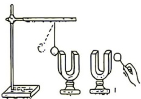
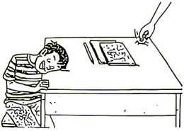
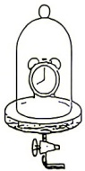
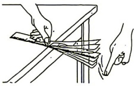

22. 在探究声音有关实验时，小李和小张做了下面的实验：

图 $①$

图 $②$

图 $③$

图 $④$

（1）如图 $①$ 所示，敲响右边的音叉，左边完全相同的音叉也会发声，且乒乓球跳动；该实验说明声音可以传递 ___ （选填“信息”或“能量”）；

（2）如图 $②$ 所示，小李同学用手轻敲桌子的一端，小张把耳朵贴在桌子的另一端可以听到清晰的声音，这个实验说明 ___ ；

（3）如图 $③$ 所示，先让电铃发声并放入玻璃罩内，再用抽气机把玻璃罩内的空气逐渐抽出，会发现声音将 ___ （选填“变大”或“变小”），通过科学推理可得 ___ ；

（4）如图 $④$ 所示，把钢尺按在桌面上，用力拨动钢尺，注意听钢尺发出的声音；接着改变钢尺伸出桌面的长度，用大小相同的力去拨动尺子，重做几次实验，观察尺子振动，同时对比所听声音。

$①$ 本实验是为了探究 ___ 的关系。

$②$ 实验时，用大小相同的力去拨动尺子的目的是为了 ___ 。

> [!question]- 点击查看答案与解析
> 【答案】（1）能量（2）固体（桌子）能够传声，且传声效果比空气好（3）变小；真空不能传声（4）$①$ 音调与钢尺振动频率（振动快慢）$②$ 控制钢尺振动的振幅相同（控制变量法）
> 
> 【考点】声音的产生与传播、声的利用、音调与频率 → [[【初中物理知识点体系-北师大版】#3-1 声音的产生与传播]]、[[【初中物理知识点体系-北师大版】#3-3 声的利用]]、[[【初中物理知识点体系-北师大版】#3-2 声音的特性]]
> 
> 【解析】
> （1）敲响右边的音叉，声波通过空气传到左边的音叉使其振动发声，并把乒乓球弹起，说明声音可以传递能量。
> （2）耳朵贴在桌面听到敲击声，说明固体（桌子）能传声，且固体传声效果比空气好。
> （3）抽出罩内空气，传声介质减少，声音逐渐变小；由此推理，若罩内完全没有空气，将听不到声音，即真空不能传声。
> （4）$①$ 改变钢尺伸出桌面的长度，就是改变钢尺振动的频率，听声音的高低变化，故探究的是音调与振动频率的关系。$②$ 用大小相同的力拨动，是为了控制钢尺振动的振幅相同，只让频率改变，属于控制变量法。
> 
> 【易错点】（3）只能听到“变小”而不能直接听到“无声”，结论要靠科学推理得出；（4）$②$ 易答成“使声音响度相同”，应强调控制振幅相同。
