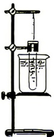
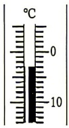
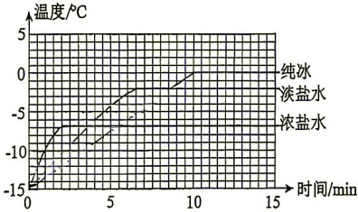
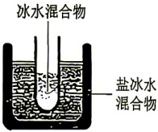

23. 物理学习小组对“除雪”展开项目探究。

（1）认识雪形成的原因。云层里，晶核周围的水蒸气围绕晶核发生 ___ （填物态变化名称）形成雪花，该过程水蒸气需要 ___ （选填“吸热”或“放热”）。

（2）探究撒盐除雪的原理。

甲

乙

丙

丁

$①$ 图丙是根据实验数据绘制的熔化图像，分析图像可知，冰在熔化过程中，温度随吸收热量变化的特点是 ___ 。

$②$ 图丙是换用相同质量的淡盐水和浓盐水制成的碎冰，用相同热源再次进行实验并绘制了熔化图像。分析可知，向冰雪路面撒盐，冰的熔点将会 ___ ，便于除雪。

（3）如图丁，将装有冰水混合物的试管放入正在熔化的盐冰水混合物中，试管内的冰将 ___ （选填“变多”“变少”或“不变”）。

> [!question]- 点击查看答案与解析
> 【答案】（1）凝华；放热（2）$①$ 吸收热量，温度保持不变 $②$ 降低（3）变多
> 
> 【考点】凝华与放热、晶体熔化图像与熔点、热传递方向 → [[【初中物理知识点体系-北师大版】#1-4 升华和凝华]]、[[【初中物理知识点体系-北师大版】#1-2 熔化和凝固]]
> 
> 【解析】
> （1）水蒸气直接变成固态的雪花，是凝华现象，凝华放热。
> （2）$①$ 由图丙可知，纯冰熔化时温度保持在 $0^{\circ}\text{C}$ 不变，即晶体熔化过程中吸热但温度保持不变。$②$ 淡盐水、浓盐水的碎冰熔点依次降低（均低于 $0^{\circ}\text{C}$），说明撒盐会降低冰的熔点，使雪在更低的温度下熔化。
> （3）盐冰水混合物的熔点低于 $0^{\circ}\text{C}$，正在熔化时温度低于 $0^{\circ}\text{C}$；试管内冰水混合物的温度为 $0^{\circ}\text{C}$，会向温度更低的盐冰水混合物放热，试管中的水凝固成冰，故冰变多。
> 
> 【易错点】误把雪的形成当成凝固或液化；第（3）问要抓住“盐冰水混合物温度低于 $0^{\circ}\text{C}$”，热由试管传给盐水，试管内水放热结冰。
