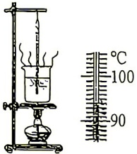
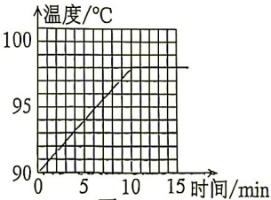
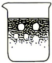
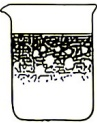

24. 小海用图甲所示装置探究水的沸腾特点。

（1）实验过程中，某时刻温度计的示数如图乙所示，此时水的温度为 ___ ℃;

（2）水沸腾时，看到水面冒“白气”，此现象产生的原因是水蒸气遇冷 ___ （填物态变化）。

（3）小海根据实验数据绘制出了水沸腾时温度和时间关系的曲线（如图丙所示）。此时水沸腾的温度是 ___ 当地的大气压 ___ （选填“高于”、“等于”或“低于”）标准大气压；

（4）在图丁和戊中，图 ___ 是水沸腾时的情况；

甲 和 乙

丙

丁

戊

（5）小海看到，从水温达到 $90^{\circ}\text{C}$ 到水沸腾共用时10min。为了节约课堂时间，请你给小海提出 $\underline{\text{一条合理化建议}}$： ___ 。

> [!question]- 点击查看答案与解析
> 【答案】（1）94（2）液化（3）98℃；低于（4）丁（5）减少水的质量（或提高水的初温、给烧杯加盖，任写一条）
> 
> 【考点】温度计的读数、液化现象、沸点与气压的关系、沸腾前后的气泡特点 → [[【初中物理知识点体系-北师大版】#1-3 汽化和液化]]、[[【初中物理知识点体系-北师大版】#1-1 温度及其测量]]
> 
> 【解析】
> （1）图乙温度计的分度值为 $1^{\circ}\text{C}$，液柱液面在 $90^{\circ}\text{C}$ 上方第 4 小格处，示数为 $94^{\circ}\text{C}$。
> （2）“白气”是水蒸气遇冷液化形成的小水滴。
> （3）图丙中温度保持在 $98^{\circ}\text{C}$ 不变，即沸点为 $98^{\circ}\text{C}$；水的沸点低于 $100^{\circ}\text{C}$，说明当地大气压低于标准大气压。
> （4）水沸腾时，气泡在上升过程中不断变大，到水面破裂；图丁中气泡上大下小，符合沸腾时的特点，图戊气泡上升变小，是沸腾前的情况。
> （5）缩短加热时间可减少水的质量、提高水的初温或给烧杯加盖减少热量散失。
> 
> 【易错点】（1）读温度计要先看分度值再读数，图乙不是 $90^{\circ}\text{C}$；（3）沸点低于 $100^{\circ}\text{C}$ 对应气压“低于”，不要写成“高于”。
