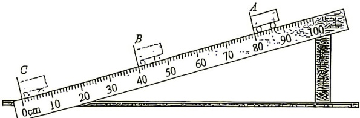
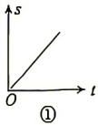
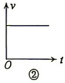
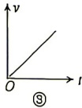

26. 芳芳和朋友去游乐场游玩，看到朋友从滑道的顶端冲下来吓得尖叫。她想知道朋友下滑时的速度如何变化，于是利用带有刻度的斜面、小车等来探究下滑过程中的速度变化情况，如图甲所示。

甲

乙

（1）该实验原理是 ___ ，除了图甲中的器材以外，还应该有的测量器材是 ___ ；

（2）实验中，应使斜面保持较 ___ （选填“大”或“小”）的坡度，以减小测量 ___ （选填“时间”或“路程”）的误差；

（3）图甲中，测得上半段的时间 $t=2s$，则 AB 段的平均速度是 ___ m/s；若小车释放后，才开始计时，则测出的 AB 段平均速度值将偏 ___ ；

（4）测得小车通过全程的时间为 3.2s，由此计算出小车AB段的平均速度为 $v_{1}$，BC段的平均速度为 $v_{2}$，则 $v_{1}$ ___ $v_{2}$（选填“＞”“＝”或“＜”）。图乙中能正确反映小车全程的运动情况的图像是 ___ （填序号）。

（5）芳芳又选用了形状相同质量不同的小车，在同一个斜面上做了多次实验，记录数据如表。分析表中数据可知： ___ 。

| 序号 | 小车的质量 | 运动距离/cm | 运动时间/s |
| --- | --- | --- | --- |
| 1 | 小 | 80.0 | 3 |
| 2 | 中 | 80.0 | 3 |
| 3 | 大 | 80.0 | 3 |

> [!question]- 点击查看答案与解析
> 【答案】（1）$v=\frac{s}{t}$；刻度尺（2）小；时间（3）0.2；大（4）＜；③（5）小车下滑的平均速度与小车的质量无关
> 
> 【考点】平均速度的测量与计算、变速运动的图像 → [[【初中物理知识点体系-北师大版】#2-4 平均速度的测量]]、[[【初中物理知识点体系-北师大版】#2-3 运动的快慢]]
> 
> 【解析】
> （1）实验原理是平均速度公式 $v=\frac{s}{t}$；图甲中已有斜面刻度，还需要用刻度尺测路程（或直接用斜面刻度），用停表测时间，故还缺的测量器材是刻度尺。
> （2）斜面坡度较小，小车下滑较慢，运动时间较长，便于准确测量时间，可减小时间的测量误差。
> （3）由图甲可知 AB 段路程 $s=0.4\text{ m}$，$t=2\text{ s}$，则 $v_{AB}=\frac{0.4\text{ m}}{2\text{ s}}=0.2\text{ m/s}$。若小车释放后才开始计时，测得的时间偏小，由 $v=\frac{s}{t}$ 可知测出的平均速度偏大。
> （4）全程 $0.8\text{ m}$、$3.2\text{ s}$；BC 段路程 $0.4\text{ m}$，时间 $3.2\text{ s}-2\text{ s}=1.2\text{ s}$，$v_{BC}=\frac{0.4\text{ m}}{1.2\text{ s}}\approx0.33\text{ m/s}>v_{AB}=0.2\text{ m/s}$，故 $v_{1}<v_{2}$。小车速度随时间增大，图③（v-t 图线向上倾斜）正确。
> （5）三组实验中质量不同，但运动距离相同、时间相同，平均速度相同，说明小车下滑的平均速度与小车的质量无关。
> 
> 【易错点】（2）误选“大”坡度，认为越快越好，实际上坡度小才便于计时；（3）注意“先释放后计时”使时间偏小、速度偏大；（4）判断图像时要先判断是 s-t 图还是 v-t 图，图③为 v-t 图，表示加速。
