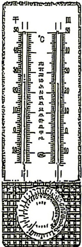

27. 阅读短文，回答问题

湿度

湿度表示空气干燥的程度的物理量，是对空气中水蒸气含量的一种度量。在一定的温度下，一定体积的空气内含有的水蒸气越少，则空气湿度越小，空气越干燥；水蒸气越多，则空气越潮湿。但是在一定温度下，一定体积的空气最多能够容纳的水蒸气是有限的。

相对湿度（RH）是表示空气湿度的一种形式。它是指一定湿度一定体积的空气中实际含有的水蒸气的质量与最多能够容纳的水蒸气质量的百分比。例如，$10^{\circ}\text{C}$ 时，$1\text{m}^{3}$ 的空气最多能够容纳8克水蒸气，如果空气中实际的水蒸气含量为 8 克，那么它的相对湿度就是 100%。

相对湿度可以用“干湿温度计”测得。如图所示，干湿温度计由两支相同的温度计并列组成，一支用来测量气温，称为干球温度计，另一支温度计的玻璃泡由一块浸满水的纱布覆盖，称为湿球温度计。两支温度计放在相同的空气中时湿球温度计的读数比干球温度计的读数要低，两支温度计出现一定的示数差。相对湿度可以通过相对湿度表（如下表）中的干球温度示数和干湿球温度计示数差查找出。表格中干球温度示数和干湿球温度计示数差两项数据相交处的数字就是相对湿度。

在医学上空气的湿度与呼吸之间的关系非常紧密。在一定的湿度下氧气比较容易通过肺泡进入血液。一般在 45~55% 的相对湿度下，人感觉呼吸最舒适。

| 干球温度 | 1℃ | 2℃ | 3℃ | 4℃ | 5℃ |
| --- | --- | --- | --- | --- | --- |
| 0℃ | 82% | 65% | 47% | 31% | 15% |
| 5℃ | 86% | 71% | 58% | 45% | 32% |
| 10℃ | 88% | 76% | 65% | 54% | 44% |
| 15℃ | 90% | 80% | 70% | 61% | 52% |
| 20℃ | 91% | 82% | 74% | 66% | 58% |
| 25℃ | 92% | 84% | 76% | 68% | 61% |
| 30℃ | 93% | 86% | 79% | 73% | 67% |
| 35℃ | 93% | 87% | 81% | 75% | 69% |

（1）湿度是表示一定空气中所含 ___ 多少的物理量；

（2）依据文中所说“10℃时，$1\text{m}^{3}$ 的空气最多能够容纳 8 克水蒸气”，如果此温度下 $1\text{m}^{3}$ 空气中实际的水蒸气含量为 2.4 克，则相对湿度是 ___ %；

（3）在相同的空气中，湿球温度计的读数比干球温度计的读数低的原因是 ___ ；

（4）在一定气温下，干湿球温度计示数差值越大，表明 ___ ；

A. 相对湿度越大，空气越干燥

B. 相对湿度越小，空气越干燥

C. 相对湿度越大，空气越潮湿

D. 相对湿度越小，空气越潮湿

（5）在和同的空气中，当干湿球温度计的示数分别为 ___ 时，人体感觉呼吸比较舒适。

A. $10^{\circ}\text{C}$ 和 $8^{\circ}\text{C}$

B. $14^{\circ}\text{C}$ 和 $9^{\circ}\text{C}$

C. $20^{\circ}\text{C}$ 和 $16^{\circ}\text{C}$

D. $24^{\circ}\text{C}$ 和 $22^{\circ}\text{C}$

> [!question]- 点击查看答案与解析
> 【答案】（1）水蒸气（2）30（3）湿球温度计玻璃泡上的水蒸发吸热，使湿球温度计的示数降低（4）B（5）B
> 
> 【考点】蒸发吸热、相对湿度与干湿温度计 → [[【初中物理知识点体系-北师大版】#1-3 汽化和液化]]
> 
> 【解析】
> （1）由短文可知，湿度是表示一定空气中所含水蒸气多少的物理量。
> （2）相对湿度 $=\frac{2.4\text{ g}}{8\text{ g}}\times100\%=30\%$。
> （3）湿球温度计的玻璃泡上包有湿纱布，纱布上的水蒸发时吸收热量，使湿球温度计的温度降低，所以其示数低于干球温度计。
> （4）由表中数据可知，在干球温度一定时，干湿球示数差越大，相对湿度越小，说明空气越干燥，故选 B。
> （5）人感觉舒适时相对湿度为 45%~55%。逐项查表：
> - A：$10^{\circ}\text{C}$ 与 $8^{\circ}\text{C}$，示数差 $2^{\circ}\text{C}$，查表得 76%，太潮湿；
> - B：$14^{\circ}\text{C}$ 与 $9^{\circ}\text{C}$，示数差 $5^{\circ}\text{C}$，介于 $10^{\circ}\text{C}$ 的 44% 与 $15^{\circ}\text{C}$ 的 52% 之间，约 50%，符合；
> - C：$20^{\circ}\text{C}$ 与 $16^{\circ}\text{C}$，示数差 $4^{\circ}\text{C}$，查表得 66%，偏潮湿；
> - D：$24^{\circ}\text{C}$ 与 $22^{\circ}\text{C}$，示数差 $2^{\circ}\text{C}$，约 84%，太潮湿。
> 
> 故选 B。
> 
> 【易错点】第（4）问不要把“示数差大”理解为“湿度大”，示数差大说明蒸发快、空气干燥；第（5）问 $14^{\circ}\text{C}$ 表中无对应行，需在 $10^{\circ}\text{C}$、$15^{\circ}\text{C}$ 两行之间比较，取 $5^{\circ}\text{C}$ 差值对应约 50%。
