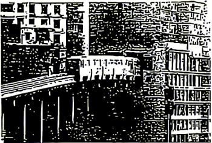

29. 如图所示，重庆轨道2号线在季子坝站“穿”楼而过，吸引众多游客至此“打卡”。若某辆列车长度 120m，匀速驶过一位在站台上静止站立的乘客所用的时间为 8s，完全穿过居民楼所用的时间为 18s，求：

（1）该列车行驶的速度；

（2）居民楼的长度：

（3）该列车穿楼过程中“完全隐没”在楼中的行驶时间。

> [!question]- 点击查看答案与解析
> 【答案】（1）$15\text{ m/s}$（2）$150\text{ m}$（3）$2\text{ s}$
> 
> 【考点】速度公式、列车过人与穿楼的路程分析 → [[【初中物理知识点体系-北师大版】#2-3 运动的快慢]]
> 
> 【解析】
> （1）列车匀速驶过静止站立的乘客，车头行驶的路程等于车长 $s_{1}=120\text{ m}$，用时 $t_{1}=8\text{ s}$，
> $v=\frac{s_{1}}{t_{1}}=\frac{120\text{ m}}{8\text{ s}}=15\text{ m/s}$。
> 
> （2）“完全穿过居民楼”指车头到达楼另一端时车尾恰好离开楼，车头行驶的路程为“车长 $+$ 楼长”。由 $s=vt$ 得
> $s_{2}=15\text{ m/s}\times18\text{ s}=270\text{ m}$，
> 楼长 $L=s_{2}-L_{\text{车}}=270\text{ m}-120\text{ m}=150\text{ m}$。
> 
> （3）“完全隐没”在楼中指车尾刚进入楼到车头刚驶出楼的过程，车头行驶的路程为
> $s_{3}=L-L_{\text{车}}=150\text{ m}-120\text{ m}=30\text{ m}$，
> 行驶时间 $t_{3}=\frac{s_{3}}{v}=\frac{30\text{ m}}{15\text{ m/s}}=2\text{ s}$。
> 
> 答：列车速度为 $15\text{ m/s}$，居民楼长 $150\text{ m}$，“完全隐没”在楼中的行驶时间为 $2\text{ s}$。
> 
> 【易错点】“完全穿过楼”的路程是“车长 $+$ 楼长”，而“完全隐没在楼中”的路程是“楼长 $-$ 车长”，两者容易混淆。
