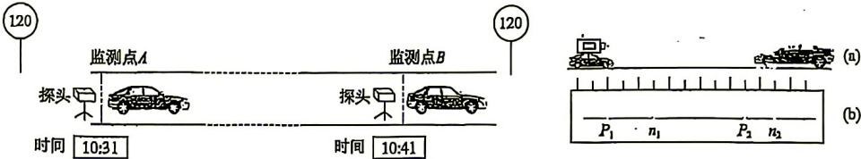

30. 据统计，全国发生的车祸中有超过四分之一是超速引起的！为此，湖北高速近年来加大了道路限速监控管理，一种是“定点测速”，即监测汽车在某点的车速；另一种是“区间测速”，就是测算出汽车在某一区间行驶的平均速度，如果超过了该路段的最高限速，即被判为超速，若监测点A、B相距15km，全程限速 120km/h，一辆轿车通过监测点A、B的速度分别为 100km/h和 110km/h，通过两个监测点的时间如图所示。

（1）采用“定点测速”，该轿车通过监测点A，B时会不会被判超速？

（2）采用“区间测速”，这辆轿车在该路段会不会被判超速？（请通过计算进行说明）

（3）停在公路旁的公安巡逻车定点测速时，利用超声波可以监测车速：巡逻车上测速仪发出并接收超声波脉冲信号，根据发出和接收到的信号间的时间差，就能测出车速。在图（b）中，$P_{1}$、$P_{2}$ 是测速仪先后发出的超声波信号，$n_{1}$、$n_{2}$ 分别是测速仪检测到的 $P_{1}$、$P_{2}$ 经反射后的信号。设测速仪匀速扫描，$P_{1}$ 与 $P_{2}$ 之间的时间间隔为 0.9s，根据图（b）可知：两次发出和接收到信号间的时间间隔 $t_{p1n1}=0.3\text{s}$，$t_{p2n2}=0.2\text{s}$，超声波在空气中传播的速度为 340m/s，假设被测汽车沿直线匀速行驶。则该车速度为多少m/s？

> [!question]- 点击查看答案与解析
> 【答案】（1）不会（2）不会，计算见解析（3）$20\text{ m/s}$
> 
> 【考点】速度公式与平均速度、超声波测距 → [[【初中物理知识点体系-北师大版】#2-3 运动的快慢]]、[[【初中物理知识点体系-北师大版】#3-1 声音的产生与传播]]
> 
> 【解析】
> （1）定点测速测得 A、B 两点的瞬时速度分别为 $100\text{ km/h}$、$110\text{ km/h}$，均小于限速 $120\text{ km/h}$，不会被判超速。
> 
> （2）由图中时间可知，轿车从 A 到 B 用时
> $t=10:41-10:31=10\text{ min}=\frac{1}{6}\text{ h}$，
> 区间平均速度
> $v=\frac{s}{t}=\frac{15\text{ km}}{\frac{1}{6}\text{ h}}=90\text{ km/h}<120\text{ km/h}$，
> 所以采用区间测速也不会被判超速。
> 
> （3）超声波从发出到遇到汽车再返回，单程时间为总时间的一半：
> $s_{1}=\frac{v_{\text{声}}t_{p1n1}}{2}=\frac{340\times0.3}{2}\text{ m}=51\text{ m}$，
> $s_{2}=\frac{v_{\text{声}}t_{p2n2}}{2}=\frac{340\times0.2}{2}\text{ m}=34\text{ m}$。
> 
> 汽车在这两段反射时间内行驶的路程
> $\Delta s=s_{1}-s_{2}=51\text{ m}-34\text{ m}=17\text{ m}$。
> 
> 汽车行驶这段路程所用的时间
> $\Delta t=0.9\text{ s}-\frac{0.3\text{ s}}{2}+\frac{0.2\text{ s}}{2}=0.85\text{ s}$（从 $P_{1}$ 反射时刻到 $P_{2}$ 反射时刻）。
> 
> 故车速
> $v_{\text{车}}=\frac{\Delta s}{\Delta t}=\frac{17\text{ m}}{0.85\text{ s}}=20\text{ m/s}$。
> 
> 答：该车速度为 $20\text{ m/s}$。
> 
> 【易错点】（2）区间测速要用“总路程除以总时间”求平均速度，不能把 $100\text{ km/h}$、$110\text{ km/h}$ 求平均当作区间速度；（3）超声波测距必须用往返时间的一半计算单程距离，两次反射的时间间隔不能直接用 0.9 s。
