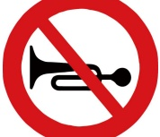

如图所示，是道路交通"禁止鸣笛"的标志，主要目的是为了控制城市的噪声污染，这种控制噪声的途径是

A. 防止噪声进入人耳

B. 阻断噪声传播

C. 防止声源产生噪声

D. 以上方式都有

> [!question]- 点击查看答案与解析
> 【答案】C
> 
> 【考点】噪声的控制 → [[【初中物理知识点体系-北师大版】#3-4 噪声的危害和控制]]
> 
> 【解析】
> - 控制噪声的三种途径：
>   1. 在声源处减弱（防止声源产生噪声）
>   2. 在传播过程中减弱（阻断噪声传播）
>   3. 在人耳处减弱（防止噪声进入人耳）
> - "禁止鸣笛"是在声源处控制噪声
> - 选项C正确
> 
> 【易错点】混淆三种控制噪声的途径。
