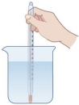
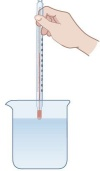
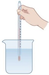
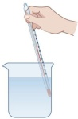

如图是用温度计测量水的温度的示意图，其中操作正确的是（）

A. 

B. 

C. 

D. 

> [!question]- 点击查看答案与解析
> 【答案】C
> 
> 【考点】温度计的使用 → [[【初中物理知识点体系-北师大版】#1-1 温度及其测量]]
> 
> 【解析】
> - 温度计正确使用要求：
>   1. 玻璃泡全部浸入被测液体中
>   2. 不要碰到容器底或容器壁
>   3. 待示数稳定后再读数
>   4. 读数时视线与液柱上表面相平
> - A：玻璃泡碰到容器底
> - B：玻璃泡碰到容器壁
> - C：操作正确
> - D：玻璃泡没有全部浸入液体中
> - 选项C正确
> 
> 【易错点】温度计玻璃泡碰到容器底或壁。
