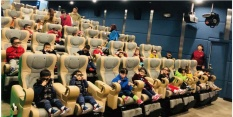

如图所示，4D电影在3D影片的基础上增加了运动座椅，随着影片的播放，观众能跟随座椅一起感受到颠簸、震颤等效果，大大增加了观众身临其境的观影融入感，在此情境中以下说法正确的是（）

A. 以座椅为参照物，地面是静止的

B. 以人为参照物，座椅是运动的

C. 以地面为参照物，人是静止的

D. 以座椅为参照物，人是静止的

> [!question]- 点击查看答案与解析
> 【答案】D
> 
> 【考点】参照物与相对运动 → [[【初中物理知识点体系-北师大版】#2-3 运动的快慢]]
> 
> 【解析】
> - 观众坐在座椅上，与座椅一起运动
> - 以座椅为参照物：
>   - 人相对座椅位置不变 → 人是静止的（D正确）
>   - 地面相对座椅位置改变 → 地面是运动的（A错误）
> - 以人为参照物：
>   - 座椅相对人位置不变 → 座椅是静止的（B错误）
> - 以地面为参照物：
>   - 人相对地面位置改变 → 人是运动的（C错误）
> - 选项D正确
> 
> 【易错点】判断相对运动时选错参照物。
