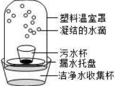

污水净化在缺水地区具有重要的意义。图示的是小东发明的太阳能净水器，可在污水净化过程中发挥积极作用。关于在塑料外罩上"凝结"形成的水滴，其物态变化名称描述正确的是（）

A. 升华

B. 液化

C. 熔化

D. 凝固

> [!question]- 点击查看答案与解析
> 【答案】B
> 
> 【考点】液化现象 → [[【初中物理知识点体系-北师大版】#1-3 汽化和液化]]
> 
> 【解析】
> - 污水中的水受热汽化为水蒸气
> - 水蒸气遇到较冷的塑料外罩，放热液化为小水滴
> - "凝结"形成水滴是气态→液态，属于液化
> - 选项B正确
> 
> 【易错点】混淆液化与凝固。
