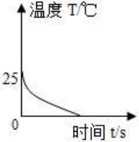
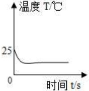
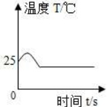
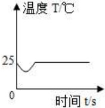

在室温为 $25^{\circ}$C的教室内，小亮给温度计的玻璃泡上涂抹少量与室温相同的酒精，观察温度计的示数变化。如图表示温度计示数随时间变化的图像中，正确的是（）

A. 

B. 

C. 

D. 

> [!question]- 点击查看答案与解析
> 【答案】C
> 
> 【考点】蒸发吸热 → [[【初中物理知识点体系-北师大版】#1-3 汽化和液化]]
> 
> 【解析】
> - 酒精蒸发需要吸热，从温度计玻璃泡吸收热量
> - 温度计示数先下降（低于25℃）
> - 酒精蒸发完后，温度计从周围空气吸热，示数回升到25℃
> - 图像特征：先下降后上升，最终稳定在25℃
> - 选项C正确
> 
> 【易错点】忽略蒸发吸热导致温度下降的过程。
