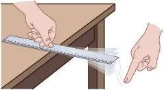

关于如图所示的有关声现象的四个实验，下列说法中正确的是（）

甲

乙

丙

丁

A. 甲：用大小不同的力敲击鼓面，听到的声音不同，同时观察到纸屑跳动的幅度不同，说明"响度与振幅有关"

B. 乙：通过观察乒乓球是否被正在发声的音叉弹起，可以探究"声音传播的条件"

C. 丙：逐渐抽取玻璃罩中的空气，听到铃声逐渐变小，可以推断真空不能传声

D. 丁：用相同大小的力拨动伸出桌面长度不同的锯条，可以探究"音调与振幅的关系"

> [!question]- 点击查看答案与解析
> 【答案】AC
> 
> 【考点】声音的特性实验 → [[【初中物理知识点体系-北师大版】#3-1 声音的产生与传播]] [[【初中物理知识点体系-北师大版】#3-2 声音的特性]]
> 
> 【解析】
> - 甲：用大小不同的力敲击鼓面，纸屑跳动幅度不同，说明振幅不同，响度不同，探究响度与振幅的关系（正确）
> - 乙：乒乓球被音叉弹起，说明音叉在振动，探究声音产生的原因，不是传播条件（错误）
> - 丙：抽气过程中铃声变小，推理得出真空不能传声（正确）
> - 丁：伸出长度不同，振动频率不同，探究音调与频率的关系，不是振幅（错误）
> - 选项AC正确
> 
> 【易错点】混淆声音特性实验的探究目的。
