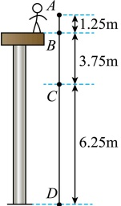

我国运动员全红婵，在2024年巴黎奥运会女子单人10米跳台决赛中，出色地完成了"207C"动作。她先从跳台起跳到A位置，再从A位置下落。将其下落阶段中的一段运动简化为直线运动，如图所示，其中A、B、C、D四点是她下落过程中的四个位置，相邻两点间的时间间隔为0.5s。下列说法中正确的是（）

A. 在AC段的平均速度为 $5~m/s$

B. 在BD段的平均速度为 $5~m/s$

C. 全红婵从起跳开始到D位置，全程做加速运动

D. 在BC段的平均速度小于CD段的平均速度

> [!question]- 点击查看答案与解析
> 【答案】CD
> 
> 【考点】平均速度的计算 → [[【初中物理知识点体系-北师大版】#2-3 运动的快慢]]
> 
> 【解析】
> - 从图中可以看出，相邻两点间的距离逐渐增大，说明速度在增加，是加速运动
> - A：AC段距离需要测量，无法直接判断是否为5m/s（需要具体数据）
> - B：BD段距离需要测量，无法直接判断是否为5m/s（需要具体数据）
> - C：从A到D，相邻点间距增大，速度增加，是加速运动（正确）
> - D：BC段距离小于CD段距离，时间相同，所以BC段平均速度小于CD段（正确）
> - 选项CD正确
> 
> 【易错点】平均速度计算需要具体距离数据，不能仅凭时间判断。
