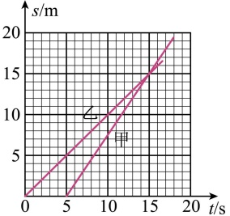

甲乙两同学沿平直路面步行，他们运动的路程随时间变化规律如图所示，下面说法中正确的是（）

A. $0\sim15s$内，甲乙同学都做匀速直线运动

B. 甲同学比乙同学晚出发5s

C. $0\sim15s$内，甲乙两同学通过的路程相等

D. $0\sim15s$内，甲乙两同学的平均速度之比为1:1

> [!question]- 点击查看答案与解析
> 【答案】BCD
> 
> 【考点】s-t图像分析 → [[【初中物理知识点体系-北师大版】#2-3 运动的快慢]]
> 
> 【解析】
> - 从图像可以看出：
>   - 甲从5s开始运动，乙从0s开始运动
>   - 甲乙的s-t图像都是直线，说明都做匀速直线运动
>   - 15s时，甲乙通过的路程相等
> - A：甲在0-5s内静止，不是全程匀速（错误）
> - B：甲从5s开始，乙从0s开始，甲晚出发5s（正确）
> - C：15s时两者路程相等（正确）
> - D：路程相等，时间相等（都是15s），平均速度相等，比值1:1（正确）
> - 选项BCD正确
> 
> 【易错点】s-t图像中斜率表示速度，水平线表示静止。
