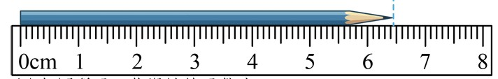
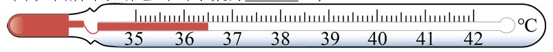
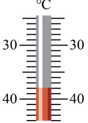

（1）图中铅笔长度的测量值是 ___ cm;

（2）如图所示，体温计的示数为 ___ ℃;

（3）图中温度计的示数是 ___ ℃。

> [!question]- 点击查看答案与解析
> 【答案】6.45；36.5；-38
> 
> 【考点】刻度尺读数、温度计读数 → [[【初中物理知识点体系-北师大版】#2-1 长度和时间的测量]] [[【初中物理知识点体系-北师大版】#1-1 温度及其测量]]
> 
> 【解析】
> - 铅笔长度：
>   - 刻度尺分度值为 1mm
>   - 左端对齐0刻度，右端在6.4cm与6.5cm之间处
>   - 需要估读到分度值下一位：6.45cm
> - 体温计示数：
>   - 水银柱位置在 36.5℃ 位置处
> - 温度计示数：
>   - 液柱在0℃以下
>   - 分度值为1℃
>   - 液面在-38℃处
> - 答案：6.45；36.5；-38
> 
> 【易错点】刻度尺读数要估读到分度值下一位；温度计读数要注意零上零下。
