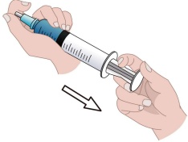

取一支较大的注射器。拉动活塞吸进一些液态乙醚（乙醚是一种化学药品）。取下针头，用橡皮帽把注射器的小孔堵住，如图所示。向外拉活塞，注射器中的液态乙醚"消失"（看不到了），这是由于液态乙醚发生了 ___ （填写物态变化的名称）。再往里推活塞，又可以看见注射器中有液态的乙醚，这是由于注射器内看不到的乙醚蒸气发生了 ___ （填写物态变化的名称），这一实验告诉我们，在一定条件下，用 ___ （选填"压缩体积"或"降低温度"）的方法能使物质由气态变为液态。

> [!question]- 点击查看答案与解析
> 【答案】汽化；液化；压缩体积
> 
> 【考点】汽化和液化 → [[【初中物理知识点体系-北师大版】#1-3 汽化和液化]]
> 
> 【解析】
> - 向外拉活塞：体积增大，压强减小，液态乙醚汽化为气态（看不见）
> - 往里推活塞：体积减小，压强增大，气态乙醚液化为液态（又能看见）
> - 实验说明：压缩体积可以使气体液化
> - 答案：汽化；液化；压缩体积
> 
> 【易错点】混淆汽化和液化的条件。
