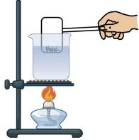

完成"碘的升华"实验时，如图所示，小宇将碘升华管放入热水中，过一会，他发现试管内弥漫着紫色的碘蒸气；将碘升华管从热水中取出，观察到管内紫色气体颜色变 ___ （选填"深"或"淡"），管壁上出现碘的小颗粒。该实验中碘先 ___ 后 ___ （填物态变化名称）。

> [!question]- 点击查看答案与解析
> 【答案】淡；升华；凝华
> 
> 【考点】升华和凝华 → [[【初中物理知识点体系-北师大版】#1-4 升华和凝华]]
> 
> 【解析】
> - 碘升华管放入热水中：固态碘吸热升华变为气态碘蒸气
> - 从热水中取出：温度降低，气态碘放热凝华为固态碘颗粒
> - 取出后碘蒸气减少，颜色变淡
> - 答案：淡；升华；凝华
> 
> 【易错点】混淆升华和凝华的条件。
