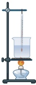
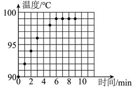
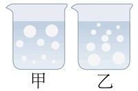

在用如图所示装置研究水的沸腾实验中，某同学观察了在加热过程中水的温度随加热时间的变化情况，并记录了如下表所示的数据：

<table border=1 style='margin: auto; word-wrap: break-word;'><tr><td style='text-align: center; word-wrap: break-word;'>时间/min</td><td style='text-align: center; word-wrap: break-word;'>0</td><td style='text-align: center; word-wrap: break-word;'>1</td><td style='text-align: center; word-wrap: break-word;'>2</td><td style='text-align: center; word-wrap: break-word;'>3</td><td style='text-align: center; word-wrap: break-word;'>4</td><td style='text-align: center; word-wrap: break-word;'>5</td><td style='text-align: center; word-wrap: break-word;'>6</td><td style='text-align: center; word-wrap: break-word;'>7</td><td style='text-align: center; word-wrap: break-word;'>8</td><td style='text-align: center; word-wrap: break-word;'>9</td></tr><tr><td style='text-align: center; word-wrap: break-word;'>温度/℃</td><td style='text-align: center; word-wrap: break-word;'>90</td><td style='text-align: center; word-wrap: break-word;'>92</td><td style='text-align: center; word-wrap: break-word;'>94</td><td style='text-align: center; word-wrap: break-word;'>96</td><td style='text-align: center; word-wrap: break-word;'>97</td><td style='text-align: center; word-wrap: break-word;'>98</td><td style='text-align: center; word-wrap: break-word;'>99</td><td style='text-align: center; word-wrap: break-word;'>99</td><td style='text-align: center; word-wrap: break-word;'>99</td><td style='text-align: center; word-wrap: break-word;'>99</td></tr></table>

(1) 该同学已根据记录的数据在图中用"·"标出了部分数据点，请你将第4min未标出的数据点用"·"标在图中，再用平滑的曲线连接这些数据点，画出水的温度随加热时间变化的图像；

(2) 根据图像可知，加热过程中水的温度变化有以下特点：

$①$ 在沸腾前，随着加热，水的温度 ___ （选填"升高"或"不变"）；

$②$ 在沸腾过程中，随着加热，水的温度 ___ （选填"升高"或"不变"）；

$③$ 在此实验中，当加热到11min时（温度计的液泡仍全部浸在水中），温度计的示数应该是 ___ ℃；

(3) 该同学测得水的沸点是 ___ ℃，由此可知水面上方气压 ___ 1个标准大气压（选填"大于"、"小于"或"等于"）：

(4) 观察到沸腾前和沸腾时水中气泡上升过程中的两种情况，如图所示，则图 ___ 是水沸腾前的情况；（选填"甲"、"乙"）

(5) 该同学觉得从开始加热到水沸腾的时间太长，请你提出一条可以缩短该实验时间的建议：

> [!question]- 点击查看答案与解析
> 【答案】(1) 略；(2) $①$升高；$②$不变；$③$ 99；(3) 99；小于；(4) 乙；(5) 减少水量/提高水的初温/给烧杯加盖
> 
> 【考点】水的沸腾实验 → [[【初中物理知识点体系-北师大版】#1-3 汽化和液化]]
> 
> 【解析】
> - (1) 第4min对应温度97℃，在图像上描点并连线
> - (2) $①$沸腾前温度升高；$②$沸腾时温度不变；$③$沸腾时温度保持99℃，11min时仍为99℃
> - (3) 水的沸点是99℃，低于100℃，说明气压小于标准大气压
> - (4) 沸腾前气泡上升变小（乙），沸腾时气泡上升变大（甲）
> - (5) 缩短加热时间的方法：减少水量、提高初温、加盖、用酒精灯外焰加热等
> 
> 【易错点】沸腾时温度不变但需要继续吸热；气压越低沸点越低。
