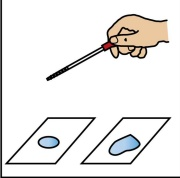
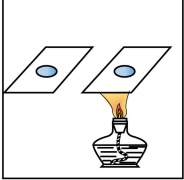
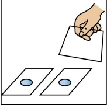

小明同学在家发现妈妈洗完衣服后总是将衣服充分展开放在阳光下或通风处晾晒，结合物理课上学过的知识，提出了"液体蒸发快慢与哪些因素有关？"的问题，并作出如下猜想：

$①$ 液体蒸发快慢与液体温度有关；

$②$ 液体蒸发快慢与液体表面积有关：

$③$ 液体蒸发快慢与液体表面上方空气流动快慢有关；

为了验证自己的猜想，小明设计了如图所示的实验，并进行实验探究：

甲

乙

丙

(1) 通过图甲的对比，可以验证猜想 ___

(2) 通过图 ___ 的对比，可以得出液体蒸发快慢与液体温度有关。

(3) 为了探究"液体蒸发快慢与液体种类是否有关"，小明继续在甲、乙两个相同的圆柱形容器中分别装入等质量的酒精和水，在相同的环境下放置一段时间后，甲中酒精消失了，乙中剩余较多水，由此现象可以得出结论：___

> [!question]- 点击查看答案与解析
> 【答案】(1) $②$；(2) 乙丙；(3) 液体蒸发快慢与液体种类有关
> 
> 【考点】影响蒸发快慢的因素 → [[【初中物理知识点体系-北师大版】#1-3 汽化和液化]]
> 
> 【解析】
> - (1) 甲图中两杯水表面积不同，其他条件相同，验证猜想$②$（液体表面积）
> - (2) 要验证温度对蒸发的影响，需控制表面积和空气流动相同，改变温度，选乙丙
> - (3) 酒精和水种类不同，其他条件相同，酒精蒸发更快，说明蒸发快慢与液体种类有关
> 
> 【易错点】控制变量法的应用：探究某个因素时，要控制其他因素相同。
