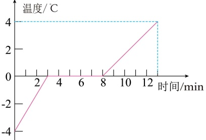

同学们通过实验"探究冰的熔化规律"，实验过程中通过水浴法对冰进行加热，记录了冰的温度随加热时间的变化情况，并正确画出了如图所示的其温度随加热时间变化的图像。

(1) 实验时应该选择颗粒 ___ 的冰块进行实验（选填"较大"或"较小"）；

(2) 根据所画出的图像可知，在开始计时后2min时物质处于 ___ 态（选填"固""液"或"固液共存"）；

(3) 冰的熔化过程经历了 ___ 分钟，冰的熔点为 ___ ℃；

(4) 另一组同学把冰放入试管中，并未用水浴法加热，冰也缓慢熔化了，于是该组同学认为冰熔化时可以不吸收热量，他们的想法是 ___ （选填"正确"或"错误"）的，理由是：___。

> [!question]- 点击查看答案与解析
> 【答案】(1) 较小；(2) 固液共存；(3) 4；0；(4) 错误；冰从周围环境吸热
> 
> 【考点】冰的熔化实验 → [[【初中物理知识点体系-北师大版】#1-2 熔化和凝固]]
> 
> 【解析】
> - (1) 选择较小颗粒的冰，受热更均匀，实验效果更好
> - (2) 从图像看，2min时处于熔化过程中，是固液共存态
> - (3) 冰从第2min开始熔化，第6min熔化结束，经历4min；熔点是0℃
> - (4) 错误，冰在室温下会从周围空气吸热，不是不吸热
> 
> 【易错点】晶体熔化时温度不变但需要继续吸热；水浴法使受热均匀。
