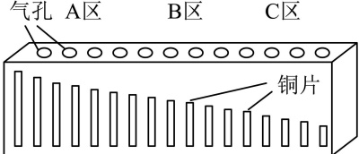

喜欢课外探究的小凯，拆开自己的口琴，口琴的琴芯结构如图所示，在琴芯的气孔边分布着长短、厚薄都不同的一排铜片，铜片在受到气流的冲击时振动，发出不同音调的声音。

(1) 在图中，A区是低音区，B区是中音区，C区是高音区，理由是：较厚较长的铜片在气流的冲击下的振动要比较薄较短的铜片振动 ___ （选填"快"或"慢"）；

(2) 往气孔用力吹气时，发出声音的音调 ___ （选填"变高"、"变低"或"不变"）；

(3) 停止吹气后，口琴仍"余音未绝"，其原因是 ___ 。

A. 这是声音的回声

B. 铜片在继续振动

C. 人的听觉发生"暂留"的缘故

> [!question]- 点击查看答案与解析
> 【答案】(1) 慢；(2) 不变；(3) B
> 
> 【考点】音调与频率的关系 → [[【初中物理知识点体系-北师大版】#3-2 声音的特性]]
> 
> 【解析】
> - (1) 低音区频率低，振动慢；高音区频率高，振动快。A区是低音区，铜片较厚较长，振动慢
> - (2) 用力吹气改变的是振幅（响度），不改变频率（音调），音调不变
> - (3) 停止吹气后，铜片由于惯性继续振动，产生声音，所以"余音未绝"
> 
> 【易错点】混淆响度和音调的影响因素；理解惯性导致振动持续。
