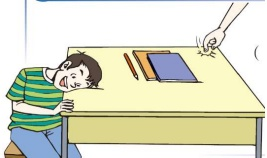

如图所示是小红和小东一起做实验证明固体能够传声的情景。下面是他们的部分实验步骤，请补充完整。

（1）小东将耳朵紧贴在桌面上，小红用手轻划桌面并逐渐增加划桌面的力度，使小东通过桌面刚好 ___ （选填"能"或"不能"）听到划桌子声；

（2）小东再把耳朵稍微离开桌面一段距离，小红用 ___ 力度，在桌面上相同位置再次划桌面，小东几乎听不到划桌子声，证明了固体能够传声。

> [!question]- 点击查看答案与解析
> 【答案】（1）不能；（2）相同
> 
> 【考点】固体传声 → [[【初中物理知识点体系-北师大版】#3-1 声音的产生与传播]]
> 
> 【解析】
> - （1）实验设计：先让耳朵贴桌面时刚好听不到声音
> - （2）耳朵离开桌面后，用相同力度划桌面，听不到声音
> - 对比说明：固体（桌面）传声效果比气体（空气）好
> - 答案：（1）不能；（2）相同
> 
> 【易错点】控制变量法的应用：两次划桌面的力度要相同。
