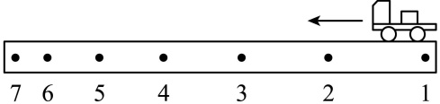

带有滴墨水装置的小车放在水平桌面上的纸带上，小车每隔相等时间 T 滴一滴墨水。当小车向左做直线运动时，在纸带上留下了一系列墨水滴，墨水滴在纸带上的分布如图所示。请回答下列问题：

（1）由此可判断出小车做 ___ （选填 "匀速" "加速" 或 "减速"）直线运动。

（2）若测出图中第1滴墨水至第7滴墨水的距离为s，则小车在此运动过程中平均速度为 $\overline{v}=$ ___ 。

> [!question]- 点击查看答案与解析
> 【答案】（1）减速；（2）$\dfrac{s}{6T}$
> 
> 【考点】平均速度的计算 → [[【初中物理知识点体系-北师大版】#2-3 运动的快慢]]
> 
> 【解析】
> - （1）从图中可以看出，相邻墨水滴间距逐渐减小，说明速度在减小，是减速运动
> - （2）第1滴到第7滴，共有6个时间间隔，总时间为6T
>   - 平均速度 $\overline{v} = \dfrac{s}{6T}$
> 
> 【易错点】数时间间隔时容易数错，第1滴到第7滴是6个间隔。