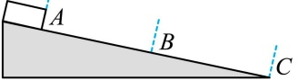

在测量木块沿斜面下滑过程中平均速度的实验中，小华采用如图所示的实验装置进行了如下测量：

$①$ 用刻度尺分别测出AB、AC间距离 $s_{1}$、$s_{2}$

$②$ 将木块从斜面顶端A点由静止释放，并同时开始计时，木块经过B点时计时器的示数为 $t_{1}$，到达C点时计时器的示数为 $t_{2}$。

(1) 木块从A下滑至C过程中的平均速度 $v_{1}$ = ___ 。

(2) 木块经过BC段的平均速度 $v_{2}$ = ___ 。

(3) 请你利用所测物理量说明如何判断木块下滑过程中可能是变速运动：___ 。

> [!question]- 点击查看答案与解析
> 【答案】(1) $\dfrac{s_2}{t_2}$；(2) $\dfrac{s_2-s_1}{t_2-t_1}$；(3) 比较 $v_1$ 和 $v_2$，若 $v_1 \neq v_2$，则木块做变速运动
> 
> 【考点】平均速度的测量 → [[【初中物理知识点体系-北师大版】#2-4 平均速度的测量]]
> 
> 【解析】
> - (1) AC段的平均速度：$v_1 = \dfrac{s_2}{t_2}$（总路程除以总时间）
> - (2) BC段的路程为 $s_2 - s_1$，时间为 $t_2 - t_1$，所以 $v_2 = \dfrac{s_2-s_1}{t_2-t_1}$
> - (3) 若木块做匀速运动，则AB段和BC段的速度应该相等；若 $v_1 \neq v_2$，说明木块在不同路段速度不同，做变速运动
> 
> 【易错点】计算BC段速度时，路程和时间要用对应段的值，不能用总路程或总时间。
