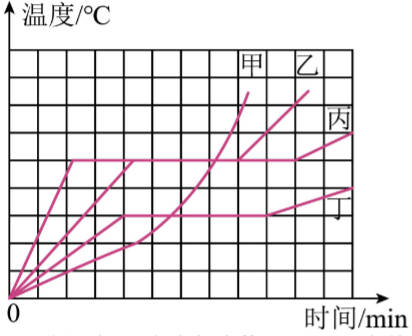

实验小组的同学们在加热条件完全相同的情况下，对甲、乙、丙、丁四个试管中的物质的熔化过程进行研究，根据记录的实验数据，在同一坐标纸上画出四种物质的温度随加热时间变化的情况如图所示。

(1) 从图中可以看出试管 ___ 中的物质是非晶体；

(2) 试管 ___ 和 ___ 中的物质可能是同一种物质，判断依据是：___ 。

> [!question]- 点击查看答案与解析
> 【答案】(1) 丁；(2) 甲和乙，熔点相同
> 
> 【考点】熔化和凝固图像分析 → [[【初中物理知识点体系-北师大版】#1-2 熔化和凝固]]
> 
> 【解析】
> - (1) 非晶体熔化时温度持续升高，没有固定的熔点（没有平台段）。从图像看，丁的图线没有水平段，温度一直在升高，所以丁是非晶体
> - (2) 同种物质的熔点相同。甲和乙的熔化图像都有水平段（平台），且平台对应的温度相同，说明它们的熔点相同，可能是同一种物质
> 
> 【易错点】判断晶体和非晶体要看是否有固定的熔点（熔化图像是否有平台段），而不是看是否吸热。
