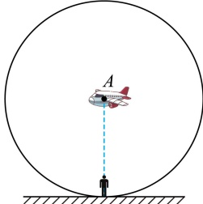

如图所示。飞机在无风的情况下水平向左飞行，当飞机飞到人的正上方A位置时，发出轰鸣声，图中的圆形表示人听到该轰鸣声时声波的情况。小明同学了解到超音速飞机是指飞行速度超过音速的飞机，他认为：当人听到轰鸣声时，飞机已掠过头顶，在人前上方，说明飞机是超音速飞机。你觉得小明同学的说法是否正确？已知该飞机为超音速飞机，请画出人听到轰鸣声时飞机所处的位置B，并说明飞机飞到位置B的理由。

> [!question]- 点击查看答案与解析
> 【答案】小明的说法不正确。飞机位置B应在人前方更远处。因为飞机速度大于声速，当声波从A传到人的时间内，飞机已飞行更远的距离。
> 
> 【考点】声速与运动 → [[【初中物理知识点体系-北师大版】#3-1 声音的产生与传播]]
> 
> 【解析】
> - 小明认为"人听到声音时飞机在前方"就说明是超音速飞机，这个推理是错误的
> - 即使飞机速度小于声速，当人听到声音时，飞机也已经飞到了前方（因为声音传播需要时间）
> - 已知飞机是超音速飞机（速度大于声速），当声波从A点向人传播的时间内，飞机飞行的距离大于声波传播的距离
> - 所以人听到轰鸣声时，飞机已经飞到了比声波传播距离更远的位置B
> - B点应该在A点的左前方（飞机飞行方向），且距离大于声波从A到人传播的距离
> 
> 【易错点】不能仅凭"听到声音时飞机在前方"就判断是超音速飞机，需要比较相同时间内飞机飞行距离和声波传播距离的大小关系。
