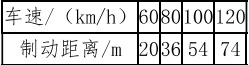
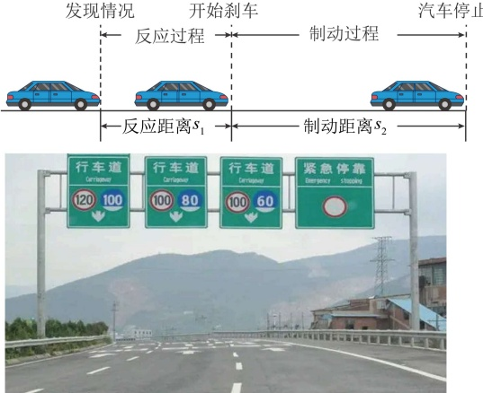

汽车遇到意外情况时紧急停车要经历反应和制动两个过程，汽车在反应过程中可认为做匀速直线运动，在制动过程中做减速直线运动，如图所示。某款汽车在高速公路的路面条件下，以不同行驶速度做紧急停车试验，其车速v与制动距离 $s_{2}$ 的试验数据如下表。通常不同司机的反应时间会有明显差异，我们将司机的反应时间取为0.72s。

（1）此款汽车以30m/s的速度在高速公路上行驶，若司机发现意外情况做紧急停车，求汽车的反应距离；

（2）《道路交通安全法实施条例》第八十条规定："机动车在高速公路上行驶，车速超过每小时100公里时，应当与同车道前车保持100米以上的距离……"请你以该款汽车为例，结合图所示高速公路多车道限速牌提供的信息，计算说明上述规定的内容是否科学合理。

> [!question]- 点击查看答案与解析
> 【答案】（1）$21.6\,m$；（2）科学合理，计算见解析
> 
> 【考点】反应距离与制动距离 → [[【初中物理知识点体系-北师大版】#2-3 运动的快慢]]
> 
> 【解析】
> - （1）反应距离 = 速度 × 反应时间
>   - $s_{反应} = v \times t_{反应} = 30\,m/s \times 0.72\,s = 21.6\,m$
> - （2）以车速100km/h（约27.8m/s）为例：
>   - 反应距离：$s_{反应} = 27.8\,m/s \times 0.72\,s \approx 20\,m$
>   - 从图表可知，100km/h对应的制动距离约为50m
>   - 总停车距离 = 反应距离 + 制动距离 = 20m + 50m = 70m
>   - 考虑到安全余量，规定100米以上的车距是科学合理的
>   - 如果车速更快（如120km/h），停车距离会更长，更需要保持较大车距
> 
> 【易错点】紧急停车距离包括反应距离和制动距离两部分，不能只计算其中一部分；要注意单位换算（km/h转m/s）。
