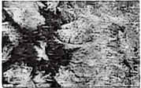
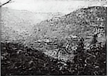
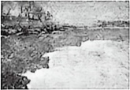

2. 如图1所示的物态变化实例中，属于熔化的是（ ）

A. 窗玻璃上出现冰花

B. 山间形成浓雾

C. 冰雪消融成水

D. 结冰的衣服会晾干

> [!question]- 点击查看答案与解析
> 【答案】C
> 
> 【考点】熔化、液化、凝华、升华的辨析 → [[【初中物理知识点体系-北师大版】#1-2 熔化和凝固]]、[[【初中物理知识点体系-北师大版】#1-3 汽化和液化]]、[[【初中物理知识点体系-北师大版】#1-4 升华和凝华]]
> 
> 【解析】
> - 选项A：冰花是空气中的水蒸气遇冷直接变成固态小冰晶，属于凝华，错误；
> - 选项B：雾是空气中的水蒸气遇冷变成小水滴，属于液化，错误；
> - 选项C：冰雪由固态变成液态的水，属于熔化，正确；
> - 选项D：结冰的衣服变干是冰直接变成水蒸气，属于升华，错误。
> 
> 【易错点】“消融”是固态变液态（熔化），而“冰花”“雾”“晾干”分别对应凝华、液化、升华，要注意判断变化前后的物态。
