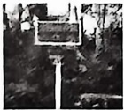
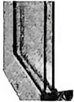
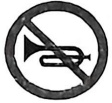
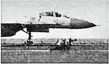

4. 如图2所示的实例中，属于在声源处减弱噪声的是（ ）

A. 街头设置噪声监测仪

B. 安装双层中空玻璃

C. 学校附近设有禁止鸣笛的标志

D. 航母上的起飞引导员需要佩戴“耳罩”

> [!question]- 点击查看答案与解析
> 【答案】C
> 
> 【考点】减弱噪声的三条途径（声源处、传播过程中、人耳处） → [[【初中物理知识点体系-北师大版】#3-4 噪声的危害和控制]]
> 
> 【解析】
> - 选项A：噪声监测仪只能显示噪声的强弱，不能减弱噪声，错误；
> - 选项B：双层中空玻璃是在传播过程中减弱噪声，错误；
> - 选项C：禁止鸣笛是从声源处防止噪声产生，正确；
> - 选项D：佩戴耳罩是在人耳处减弱噪声，错误。
> 
> 【易错点】“监测噪声”不等于“减弱噪声”；判断时要看清措施作用在声源、传播路径还是人耳。
