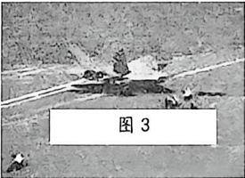

10. 2025年9月22日，中国海军福建舰的电磁弹射试验视频震撼发布，如图3所示，舰载机弹射过程中，其飞行员看到甲板上的地勤人员在向后退，则飞行员选择的参照物是（ ）

A. 云朵

B. 地勤人员

C. 舰载机

D. 福建舰

> [!question]- 点击查看答案与解析
> 【答案】C
> 
> 【考点】参照物与机械运动 → [[【初中物理知识点体系-北师大版】#2-2 运动的描述]]
> 
> 【解析】
> 地勤人员相对甲板静止。弹射时舰载机（飞行员）相对甲板向前运动，以舰载机为参照物，地勤人员的位置不断向后改变，所以看到其在后退。
> - 选项A：以云朵为参照物，地勤人员的位置变化情况不能确定；
> - 选项B：不能以被观察的地勤人员自身为参照物判断其是否运动；
> - 选项C：以舰载机为参照物，地勤人员向后退，正确；
> - 选项D：以福建舰为参照物，地勤人员是静止的，错误。
> 
> 【易错点】判断“向后退”时要把参照物与被观察对象的相对位置变化对应起来，先明确地勤人员相对甲板静止。
