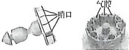

12. 抖空竹是中国民间传统游戏之一，宋代《梦粱录》中就有其详细记载。如图4，空竹圆轮以竹木制成，其外侧开有若干矩形哨口，哨口内有大小不同的气腔，其转动时会发出嗡嗡声，又名“空钟”。下列说法正确的是（ ）

A. 空竹发出的声音是通过固体传入人耳的

B. 空竹发出的声音是由气腔内空气振动产生的

C. 气腔内空气振动越快，声音传播的速度越大

D. 气腔内空气振幅越大，发出声音的音调越高

> [!question]- 点击查看答案与解析
> 【答案】B
> 
> 【考点】声音的产生与传播、声音的特性 → [[【初中物理知识点体系-北师大版】#3-1 声音的产生与传播]]、[[【初中物理知识点体系-北师大版】#3-2 声音的特性]]
> 
> 【解析】
> - 选项A：空竹与人耳之间主要是空气，声音通过空气传入人耳，错误；
> - 选项B：吹哨时是气腔内的空气振动发声，正确；
> - 选项C：声速由介质种类和温度决定，与振动快慢无关，错误；
> - 选项D：振幅越大响度越大，音调由振动频率决定，错误。
> 
> 【易错点】把“振动加快”与“声速变大”混淆；把“振幅”与“音调”对应错。
