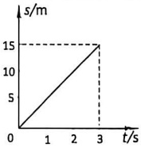
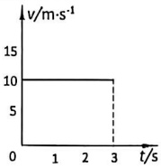
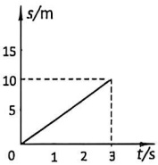

13. 如图5所示为甲、乙、丙三个物体运动的 $s-t$ 图象或 $v-t$ 图象，则在 $3\text{s}$ 这段时间内，物体的运动快慢情况描述正确的是（ ）

甲

乙

丙

图5

A. 甲最快

B. 乙最快

C. 丙最快

D. 乙始终处于静止状态

> [!question]- 点击查看答案与解析
> 【答案】B
> 
> 【考点】$s-t$ 图象与 $v-t$ 图象的识别、速度的比较 → [[【初中物理知识点体系-北师大版】#2-3 运动的快慢]]
> 
> 【解析】
> - 甲图是 $s-t$ 图象：$3\text{s}$ 内通过 $15\text{ m}$，$v_{甲}=\frac{15\text{ m}}{3\text{ s}}=5\text{ m/s}$；
> - 乙图是 $v-t$ 图象：速度始终为 $10\text{ m/s}$，做匀速直线运动，$3\text{ s}$ 内通过 $30\text{ m}$；
> - 丙图是 $s-t$ 图象：$3\text{s}$ 内通过 $10\text{ m}$，$v_{丙}=\frac{10\text{ m}}{3\text{ s}}\approx3.3\text{ m/s}$。
> 比较可得 $v_{乙}>v_{甲}>v_{丙}$，所以乙最快。
> - 选项A、C：与计算结果不符，错误；
> - 选项B：乙最快，正确；
> - 选项D：乙图是 $v-t$ 图象且速度不为零，乙做匀速直线运动，错误。
> 
> 【易错点】把 $v-t$ 图象误当成 $s-t$ 图象，看到“横线”就认为物体静止；图象题的纵轴符号是判断关键。
