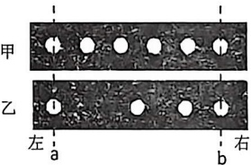

14. “频闪摄影”是研究物体运动时常用的一种实验方法。摄影在暗室中进行，闪光灯每隔相同的时间闪亮一次，底片就记录下这时物体的位置。如图6是甲、乙两个网球沿水平面从左向右运动时的频闪照片，则下列说法正确的是（ ）

图6

A. 从 a 到 b，甲球运动的距离比乙球短

B. 从 a 到 b，甲球运动的时间比乙球短

C. 乙球的运动速度越来越大

D. 甲球可能做匀速直线运动

> [!question]- 点击查看答案与解析
> 【答案】CD
> 
> 【考点】频闪照片分析、匀速与变速运动 → [[【初中物理知识点体系-北师大版】#2-3 运动的快慢]]
> 
> 【解析】
> 闪光灯每隔相同时间闪亮一次，因此相邻两个像之间的时间间隔相等。
> - 选项A：甲、乙都是从 a 位置运动到 b 位置，通过的距离相同，错误；
> - 选项B：甲的像有 6 个（5 个时间间隔），乙的像有 4 个（3 个时间间隔），甲所用时间更长，错误；
> - 选项C：乙相邻像的间距逐渐变大，相同时间内通过的路程越来越大，速度越来越大，正确；
> - 选项D：甲相邻像的间距相等，相同时间内通过的路程相等，做匀速直线运动，正确。
> 
> 【易错点】数“像的个数”时忘记间隔数比像数少 1；把间距变大误认为速度变小。
