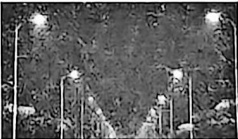

15. 在平直的公路上，小明观察到大巴车上的车速显示屏始终显示 $108\text{ km/h}$。他用秒表测出大巴车由第1根路灯杆行驶到第6根路灯杆的时间为 $10\text{ s}$。若相邻路灯杆之间距离相等（如图7），则相邻两根路灯杆之间的距离是（ ）

A. $30\text{m}$

B. $50\text{m}$

C. $60\text{m}$

D. $300\text{m}$

> [!question]- 点击查看答案与解析
> 【答案】C
> 
> 【考点】速度公式的应用、单位换算 → [[【初中物理知识点体系-北师大版】#2-3 运动的快慢]]
> 
> 【解析】
> 先把速度换算成国际单位：$v=108\text{ km/h}=108\times\frac{1}{3.6}\text{ m/s}=30\text{ m/s}$。
> 从第1根到第6根路灯杆共有 $6-1=5$ 个间隔，$10\text{ s}$ 内通过的路程为 $s=vt=30\text{ m/s}\times10\text{ s}=300\text{ m}$。
> 相邻两根路灯杆之间的距离为 $\frac{300\text{ m}}{5}=60\text{ m}$。
> - 选项A、B：均小于计算结果，错误；
> - 选项C：$60\text{ m}$，正确；
> - 选项D：$300\text{ m}$ 是 $10\text{ s}$ 内的总路程，不是相邻杆间距，错误。
> 
> 【易错点】“第1根到第6根”是5个间隔而不是6个；忘记把 km/h 换算成 m/s。
