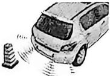
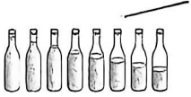
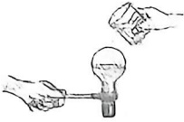
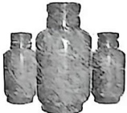

19. 关于图9所示的四个情景，下列说法正确的是（ ）

甲：倒车雷达

乙：用力敲击玻璃瓶侧壁

丙：烧瓶里的水重新沸腾

丁：液化石油气罐

图9

A. 甲图：倒车雷达是利用超声波传递信息来进行工作的

B. 乙图：用同样大小的力从左向右敲击玻璃瓶，音调会逐渐变高

C. 丙图：在烧瓶底部浇冷水使停止沸腾的水重新沸腾，说明液体的沸点跟大气压有关

D. 丁图：液化石油气主要是利用压缩体积的方法，使燃气液化储存在钢瓶内的

> [!question]- 点击查看答案与解析
> 【答案】ACD
> 
> 【考点】声的利用、音调与频率、沸点与气压的关系、液化的方法 → [[【初中物理知识点体系-北师大版】#3-3 声的利用]]、[[【初中物理知识点体系-北师大版】#3-2 声音的特性]]、[[【初中物理知识点体系-北师大版】#1-3 汽化和液化]]
> 
> 【解析】
> - 选项A：倒车雷达利用超声波传递信息（回声定位）判断障碍物，正确；
> - 选项B：敲击瓶壁时发声体是瓶和水，从左向右瓶内水量逐渐增多，振动部分质量增大、频率降低，音调逐渐变低而不是变高，错误；
> - 选项C：浇冷水使烧瓶内气压降低，水的沸点降低，停止沸腾的水重新沸腾，说明沸点与大气压有关，正确；
> - 选项D：石油气在常温下压缩体积使其液化，便于装入钢瓶，正确。
> 
> 【易错点】B 项易凭“水量多则声音高”的错误直觉判断，实际敲击水瓶时水越多音调越低。
