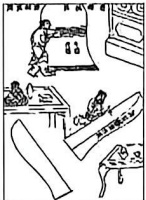

20. 我国古代科技著作《天工开物》里记载了铸造“万钧钟”和“鼎”的方法，先用泥土制作“模骨”，“干燥之后以牛油、黄蜡附其上数寸”，在油蜡上刻上各种图案（如图10），然后在油蜡的外面用泥土制成外壳；干燥之后，“外施火力炙化其中油蜡”，油蜡流出形成空腔，在空腔中倒入铜液，待铜液冷却后，“钟鼎成矣”。下列说法正确的是（ ）

A. “炙化其中油蜡” 是熔化过程

B. “炙化其中油蜡” 的过程中，温度保持不变

C. 铜液冷却成钟鼎是凝华过程

D. 铜液冷却成钟鼎的过程中，不断放出热量

> [!question]- 点击查看答案与解析
> 【答案】AD
> 
> 【考点】熔化与凝固的特点及应用 → [[【初中物理知识点体系-北师大版】#1-2 熔化和凝固]]
> 
> 【解析】
> - 选项A：油蜡受热由固态变为液态流出，属于熔化，正确；
> - 选项B：蜡是非晶体，熔化过程中吸收热量、温度不断升高，没有固定的熔化温度，错误；
> - 选项C：铜液由液态变为固态是凝固，不是凝华（凝华是气态直接变固态），错误；
> - 选项D：凝固过程不断放热，正确。
> 
> 【易错点】把非晶体蜡的熔化当作“温度不变”；把“液态变固态”误判为凝华。
