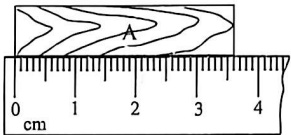
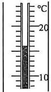

21. （1）如图11所示，物体A的长度为 ___ cm。

图11

（2）如图12所示，温度计的示数为 ___ ℃。

图12

> [!question]- 点击查看答案与解析
> 【答案】（1）$3.60$；（2）$16$
> 
> 【考点】刻度尺的读数、温度计的读数 → [[【初中物理知识点体系-北师大版】#2-1 长度和时间的测量]]、[[【初中物理知识点体系-北师大版】#1-1 温度及其测量]]
> 
> 【解析】
> （1）刻度尺的分度值为 $1\text{ mm}=0.1\text{ cm}$。物体A左端与 $0$ 刻度线对齐，右端在 $3.6\text{ cm}$ 处，读数需估读到分度值的下一位，故为 $3.60\text{ cm}$。
> （2）温度计的分度值为 $1^{\circ}\text{C}$，液面在 $10^{\circ}\text{C}$ 上方第 6 个小格处，示数为 $16^{\circ}\text{C}$。
> 
> 【易错点】长度读数漏掉估读位（写成 $3.5\text{ cm}$）；温度计读数时不看分度值、从上往下数格。
