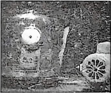

22. 如图13所示，把正在响铃的小闹钟放在密闭玻璃罩内，逐渐抽出其中的空气，你听到的铃声会 ___ ，这个现象说明 ___ 。这样研究问题的方法是 ___ 。（选填“转换法”或“科学推理法”）

> [!question]- 点击查看答案与解析
> 【答案】变小（减弱）；真空不能传声（声音的传播需要介质）；科学推理法
> 
> 【考点】声音的传播需要介质 → [[【初中物理知识点体系-北师大版】#3-1 声音的产生与传播]]
> 
> 【解析】
> 用抽气机逐渐抽出玻璃罩内的空气，传播声音的介质越来越少，听到的铃声逐渐变弱；由此可推理：若罩内成为真空，将完全听不到声音，说明声音不能在真空中传播，声音的传播需要介质（固体、液体、气体）。
> 由于无法把玻璃罩抽成绝对真空，只能在实验事实（声音逐渐变弱）的基础上进行合理推理，这种方法叫科学推理法。
> 
> 【易错点】把该实验说成“转换法”；表述结论时只写“真空不能传声”而漏掉“声音的传播需要介质”。
